# LimboQueue

Velocity and Folia queue system that places waiting players in a lightweight limbo world.

## Workflow

1. Player joins proxy.
2. Check backend capacity.
3. Assign queue priority.
4. Send player to backend when ready.

## Getting started

Build with `./gradlew build`. Install the Velocity and Folia modules in their matching servers.

## License

The project code is licensed under AGPL-3.0-only. See [LICENSE](LICENSE).
